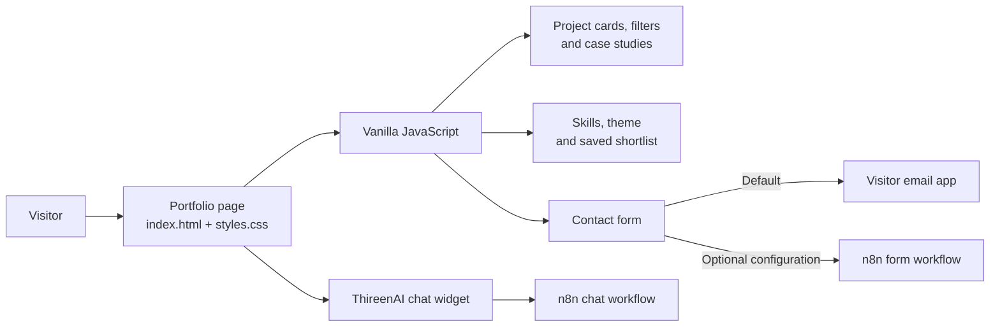

<p align="center">
  <a href="https://tansiv.github.io/Tansiv_Jubayer_portfolio-website/">
    
  </a>
</p>

<h1 align="center">Tansiv Jubayer</h1>
<p align="center"><strong>Data Analytics · Machine Learning · Data Engineering</strong></p>
<p align="center">A polished, accessible portfolio for selected projects, research, and professional collaboration.</p>

<p align="center">
  <a href="https://tansiv.github.io/Tansiv_Jubayer_portfolio-website/">Visit the live portfolio</a>
  ·
  <a href="https://github.com/Tansiv/Tansiv_Jubayer_portfolio-website/issues">Report an issue</a>
  ·
  <a href="mailto:jtansiv@gmail.com">Contact</a>
</p>

<p align="center">
  <a href="https://github.com/Tansiv/Tansiv_Jubayer_portfolio-website/stargazers">
    
  </a>
  
  
  
</p>

---

## Overview

This repository contains the source for **Tansiv Jubayer's personal portfolio**, presenting work across data analysis, applied machine learning, data engineering, research, and software development. It is designed as a fast, direct introduction to the work: visitors can explore project case studies, review publications and capabilities, save projects locally, and get in touch.

The site uses semantic HTML, custom responsive CSS, and browser-native JavaScript. There is no framework, build step, package manager, or server-side application required.

## Portfolio features

| Area | Highlights |
| --- | --- |
| Projects | Six selected projects, category filters, case-study dialogs, and a locally saved shortlist |
| Research | Four publication entries across forecasting, computer vision, agriculture, and predictive modelling |
| Profile | Experience, education, services, certifications, and downloadable CV |
| Navigation | Responsive menu, keyboard-accessible quick navigation, and scroll progress |
| Presentation | Light and dark themes, responsive layouts, motion effects, and reduced-motion support |
| Contact | Client-side validation, email-draft fallback, and optional n8n form delivery |
| Assistant | ThireenAI portfolio chat powered by the n8n chat widget |
| Metadata | Open Graph tags, a Person JSON-LD profile, page description, and SVG favicon |

## Architecture



<p align="center"><em>Figure 1. Browser-side portfolio features and optional external integrations.</em></p>

## Technology

- **HTML5** for semantic structure and metadata
- **CSS3** for responsive layouts, themes, motion, and the visual system
- **Vanilla JavaScript** for project and skill rendering, navigation, filtering, and form behavior
- **n8n Chat** for the embedded ThireenAI assistant
- **GitHub Pages** for static hosting

## Repository contents

```text
.
├── index.html                 # Page content, metadata, and chat initialization
├── styles.css                 # Design tokens, components, and responsive styling
├── script.js                  # Project data, rendering, interactions, and form logic
├── README.md                  # Project overview and developer guide
└── assets/
    ├── favicon.svg            # Browser and README monogram
    ├── my_photo.jpg           # Optimized portfolio portrait
    ├── my_photo.png           # Original portrait source
    └── Tansiv_Jubayer_CV.pdf  # Downloadable CV
```

## Run locally

**Requirements:** Python 3 for the optional local web server. No dependencies need to be installed.

```bash
git clone https://github.com/Tansiv/Tansiv_Jubayer_portfolio-website.git
cd Tansiv_Jubayer_portfolio-website
python -m http.server 8000
```

Open [http://localhost:8000](http://localhost:8000) in a browser. You can also open `index.html` directly or use another static server such as the VS Code Live Server extension.

## Customize the site

| Change | File |
| --- | --- |
| Hero, research, profile, contact details, and links | `index.html` |
| Project descriptions, categories, outcomes, and skills | `script.js` |
| Colors, typography, layout, and responsive behavior | `styles.css` |
| Portrait, favicon, or CV | `assets/` |

Projects and skill groups are maintained as JavaScript data and rendered into the page. Keep professional claims, publication details, project metrics, and links accurate when editing them. The main design tokens are defined near the beginning of `styles.css`.

## Contact and chatbot integrations

### Contact form

The form validates the visitor's name, email, and message in the browser; topic is optional metadata. By default, it opens a prepared email to `jtansiv@gmail.com`; it does not require a backend.

To send form submissions to your own n8n workflow, set `N8N_WEBHOOK_URL` near the contact-form logic in `script.js` to an HTTPS production webhook. Configure the workflow to accept the JSON payload, allow the deployed site origin through CORS, and return a successful response when the message is accepted.

### ThireenAI

The portfolio assistant is initialized in `index.html` with the `@n8n/chat` package from jsDelivr and a configured n8n chat workflow. The browser must be online for the external font, chat package, and assistant service to load.

> **Security:** Browser-side webhook URLs are public. Never put API keys, credentials, or private tokens in HTML or JavaScript. Add rate limiting, spam controls, and server-side validation to workflows that process visitor input.

## Deploy with GitHub Pages

The portfolio is available at [tansiv.github.io/Tansiv_Jubayer_portfolio-website](https://tansiv.github.io/Tansiv_Jubayer_portfolio-website/). To configure or verify deployment, open the repository's **Settings → Pages** and select **Deploy from a branch**, branch **`main`**, folder **`/(root)`**. No build command is needed.

After publishing changes, allow GitHub Pages a short time to deploy, then verify the live page, image and CV links, mobile navigation, and the contact flow.

## Contributing and Git workflow

This is a personal portfolio, but corrections and thoughtful suggestions are welcome through [GitHub Issues](https://github.com/Tansiv/Tansiv_Jubayer_portfolio-website/issues). For a change, use a branch and review the diff before opening a pull request:

```bash
git switch -c docs-or-fix/short-description
# Make and review your changes
git diff --check
git add README.md
git commit -m "Improve portfolio documentation"
git push -u origin docs-or-fix/short-description
```

If this project was useful or you would like to follow its updates, you can [star the repository](https://github.com/Tansiv/Tansiv_Jubayer_portfolio-website/stargazers).

## Accessibility and performance

- Semantic landmarks and a skip link support assistive technology and keyboard navigation.
- Interactive controls expose accessible labels and state; dialogs and quick navigation support keyboard use.
- Reduced-motion preferences are respected.
- The hero portrait declares dimensions and uses prioritized loading to reduce layout shift.
- Project and skill content is rendered with DOM APIs rather than interpolated HTML strings.
- Theme and shortlist preferences use browser storage when it is available.

## Further reading

- [GitHub README guidance](https://docs.github.com/en/repositories/managing-your-repositorys-settings-and-features/customizing-your-repository/about-readmes)
- [GitHub Mermaid diagrams](https://docs.github.com/en/get-started/writing-on-github/working-with-advanced-formatting/creating-diagrams)
- [GitHub Pages documentation](https://docs.github.com/en/pages)
- [n8n Chat documentation](https://www.npmjs.com/package/@n8n/chat)
- [Shields.io badge documentation](https://shields.io/)

## Content and reuse

This repository includes personal identity, career, and project information. Please do not reuse the portrait, CV, personal details, or project claims without permission. No standalone open-source license is included in this repository.
